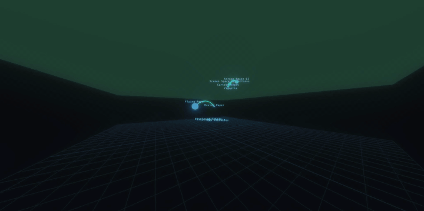

# tsl-lab

A daily-experiment sprint in **Three.js Shading Language (TSL) + WebGPU**: one shader, one bug, one small win at a time.

25 days, 11 years of frontend, zero prior shader experience. Built in public on the way to Three.js Conference Paris 2026.

**Live:** https://tsl-lab.vercel.app · **Build log:** [@B1llCreator on X](https://x.com/B1llCreator)



<sub>[Full-quality video](public/hud/fallback-vid.mp4) (28s)</sub>

## Experiments

| Route | What it is | Source |
|---|---|---|
| [`/hud`](https://tsl-lab.vercel.app/hud) | **Heads-Up Display**: a network map of the lab itself. Every node is an experiment and every arc is a technique they share. Has a boot animation and a video fallback when WebGPU isn't available. | `src/hud/` |
| [`/ssr`](https://tsl-lab.vercel.app/ssr) | **Mirror Floor**: Screen Space Reflections built from MRT outputs (normals, metalness, roughness). | `src/ssr.ts` |
| [`/instancing`](https://tsl-lab.vercel.app/instancing) | **Ten Thousand, One Draw Call**: 10k instances, each with position, color and scale derived from a hash on the GPU. There is no per-object JS loop. | `src/instancing.ts` |
| [`/texture`](https://tsl-lab.vercel.app/texture) | **No Seams at the Poles**: triplanar mapping on a noise-displaced sphere. | `src/texture.ts` |
| [`/flying-paper`](https://tsl-lab.vercel.app/flying-paper) | **Half a Million Points, Still 60fps**: compute-shader particles with curl noise, swirl and self-rotation. | `src/flying-paper.ts` |
| [`/moving-paper`](https://tsl-lab.vercel.app/moving-paper) | **Paper Storm**: 500k GPU particles driven by curl-noise flow fields, vortex forces and mouse interaction. | `src/moving-paper.ts` |
| [`/postprocessing`](https://tsl-lab.vercel.app/postprocessing) | **Finding Edges Without an Edge Detector**: vignette plus edge detection via MRT, comparing screen-space normals with a dot product (no Sobel). | `src/postprocessing.ts` |

## Stack

- [three.js](https://threejs.org) `WebGPURenderer` + TSL (`three/webgpu`, `three/tsl`): compute shaders, `instancedArray`, MRT, post-processing nodes
- [GSAP](https://gsap.com) for camera animation
- [lil-gui](https://lil-gui.georgealways.com) + [stats-gl](https://github.com/RenaudRohlinger/stats-gl) for tweaking and profiling
- Vite multi-page build + TypeScript, no framework

## Running locally

```bash
npm install
npm run dev       # http://localhost:5173
npm run build     # type-check + build every page into dist/
npm run preview
```

You need a browser with **WebGPU** (recent Chrome/Edge, Safari 26+, or Firefox with WebGPU enabled). Each experiment is its own HTML entry, listed in `vite.config.js`.

## Credits

- ["Bed Monster"](https://skfb.ly/pMxoB) by Shedletsky_2, licensed [CC BY 4.0](http://creativecommons.org/licenses/by/4.0/)
- Gray rocks texture from [Poly Haven](https://polyhaven.com) (CC0)

## License

The code is MIT-licensed (see [LICENSE](LICENSE)). Third-party assets in `public/` keep their own licenses, listed above.
